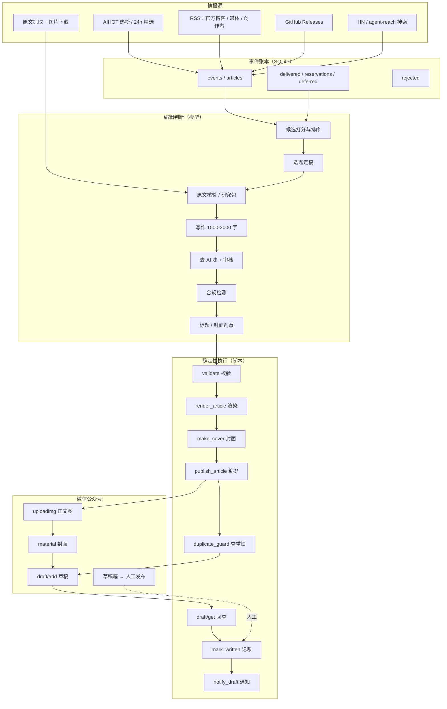

# 公众号 AI 编辑流水线

一套把「找选题 → 核验 → 写作 → 去 AI 味 → 合规 → 排版 → 配图 → 进草稿箱」串成一条流水线的自动化系统，服务于一个真实的微信公众号日更账号。

它不是「一键生成爆款」的写作器。它解决的是另一个更麻烦的问题：**每天都能稳定产出一篇事实站得住、格式能过、可以人工点发布的稿子**，并且在无人值守的凌晨也不会把旧闻重发一遍。

> 默认终点是**微信公众号草稿箱**，不是自动发布。订阅号没有发布接口权限，最后一步由人在后台完成。

---

## 目录

- [为什么需要它](#为什么需要它)
- [核心设计](#核心设计)
- [整体架构](#整体架构)
- [三条调度线](#三条调度线)
- [十个阶段](#十个阶段)
- [关键模块](#关键模块)
- [数据与状态](#数据与状态)
- [三层去重](#三层去重)
- [排版与封面](#排版与封面)
- [安全与合规](#安全与合规)
- [快速开始](#快速开始)
- [配置项](#配置项)
- [目录结构](#目录结构)
- [常见问题](#常见问题)
- [已知限制](#已知限制)

---

## 为什么需要它

公众号日更的真实成本不在「写 2000 字」，而在下面这些重复且容易出错的环节：

| 环节 | 人工做法 | 容易出的问题 |
|---|---|---|
| 找选题 | 刷 AIHOT、36 氪、X、GitHub | 漏掉凌晨发布的海外消息；被旧闻重炒骗 |
| 核验 | 打开原文、对时间、对数字 | 把传闻写成官宣；把二手摘要当原文 |
| 写作 | 从零敲 | 越写越像通稿；事实和观点混在一起 |
| 去 AI 味 | 凭感觉删 | 删掉事实，留下空话 |
| 配图 | 图库搜图 | 图片与正文对不上；热链失效；版权风险 |
| 排版 | 微信编辑器手调 | 样式不统一；暗黑模式白底；图片顺序错 |
| 上传 | 复制粘贴 | 摘要超字节；封面漏传；旧稿没删 |

这套系统把其中**可判定**的部分交给脚本，把**需要判断**的部分交给模型，再用几道硬闸门把两者隔开：

- 脚本负责：抓取、去重、校验、渲染、上传、回查、记账、通知。
- 模型负责：选题判断、原文核验、写作、审稿、标题、封面创意。
- 硬闸门负责：**没有通过校验的稿子，物理上无法进入草稿箱。**

最后一点是整个项目最重要的设计。提示词可以写「禁止重复」，但模型可能忘；代码里的 `wechat_duplicate_guard.py` 不会忘，因为它直接接管了 `draft/add` 请求。

---

## 核心设计

### 1. 判断与执行分离

模型的输出是**提案**，不是**事实**。所有关键动作都要再经过一次确定性检查：

- 选题提案要过 `ai_news.py validate`：标题必须点名主体，事件必须能解析到真实 `event_id`，原文链接必须是 HTTP(S) 且不是示例域名。
- 文章要过 `publish_article.py`：首行必须是标题、图片数与图注数必须一致、封面必须 1880×800、摘要必须 ≤70 字节。
- 上传要过 `wechat_duplicate_guard.py`：实时读草稿箱、读已发表列表、比对本地历史，命中即拒绝。
- 上传后要过 `draft/get` 回查：标题、摘要、图片数量、图片顺序、封面 `media_id`、有无本地路径，逐项比对。

任何一项失败，流程停止，不通知成功。

### 2. 只追加，不覆盖

- 事件库 `events.sqlite3` 只追加观察记录，不因标题变化改写历史。
- 已进草稿箱或已发布的稿子写入 `written.jsonl` / `daily_written.jsonl`，即使草稿被删除，仍参与后续查重。
- 主流水线在阶段 10 会先按提示词清理同栏目旧版本；`publish_article.py` 本身不删除任何历史草稿，避免误删。

### 3. 失败要响，不能静默

- 抓取源失败会记录 `health`，不会把「没抓到」当成「没有新闻」。
- 通知走 SQLite 队列，失败后按 1/2/4/8/15 分钟退避重试，进程重启不丢。
- 上传回查失败直接非零退出，不写成功回执。

### 4. 账号风格是配置，不是代码

选题优先级、栏目、作者名、版式、封面规则都在 `templates/` 和 `config/` 里。换一个账号，改配置和提示词即可，不用改流水线。

---

## 整体架构



### 组件边界

| 层 | 职责 | 不做什么 |
|---|---|---|
| 采集层 `ai_news.py` | 拉源、归一化、事件聚类、健康记录 | 不调用 LLM，不发通知 |
| 选题层 `hot_editor.py` | 规则打分、优先级排序、配额与冷却 | 不写稿，不判断事实真假 |
| 编辑层（模型） | 核验、写作、审稿、标题、封面文案 | 不直接调微信接口 |
| 执行层 `publish_article.py` | 渲染、上传、建稿、回查、记账、通知 | 不修改文章观点 |
| 闸门层 `wechat_duplicate_guard.py` | 查重、互斥锁、拦截自动发布 | 不生成内容 |

---

## 三条调度线

生产环境用 Hermes cron 触发，三条线共用同一套账本和上传入口。

| 任务 | 时间（北京时间） | 作用 | 入口 |
|---|---|---|---|
| 主流水线 | 每天 05:30 | 一口气跑完 10 个阶段，07:00 前落到草稿箱 | 模型任务，按提示词执行 |
| 热点监控 | 08:00–23:00 每 20 分钟 | 有新事件才唤醒写作；每天最多 2 篇 | `scripts/trigger.py --mode hot` |
| 质量兜底 | 每天 20:00 | 当天没有合格热点时补一次，不硬凑 | `scripts/trigger.py --mode fallback` |
| 日报 | 每天 08:02 | 10–16 条 AI 新闻汇总，统一版式 | `scripts/trigger.py --mode daily` |

为什么主流水线放在 05:30：对应美东 17:30 / 美西 14:30，美国当天的主要 AI 新闻已经发完，而国内同行还没开工。这是一个刻意选择的时间窗口，不是随便定的。

热点监控不是「每 20 分钟写一篇」。它每 20 分钟**只看不写**：采集 → 打分 → 有合格候选且当天配额未满，才唤醒写作 agent。没有合格内容就结束，允许当天空缺。

---

## 十个阶段

主流水线的完整定义在 `docs/pipeline.md`，这里是压缩版。

| # | 阶段 | 主要动作 | 产物 / 通过标准 |
|---|---|---|---|
| 1 | 情报抓取 | AIHOT 热榜 + 24h 精选、RSS、GitHub、中文源 | 候选事件入库，记录来源健康度 |
| 2 | 选题定稿 | 三维打分：热度 30% / 相关度 40% / 切入价值 30% | 1 个主选题 + 2 个备选，避开 7 天内写过 |
| 3 | 调研核验 | 官方博客、X、GitHub release、论文原文 | 每条关键事实带链接 + 核验状态 |
| 4 | 写作 | 1500–2000 字，第一人称，具体数字，承认失败 | Markdown 初稿 |
| 5 | 去 AI 味 + 审稿 | Humanizer 去空话；审稿核对来源与观点 | 修改后的终稿 |
| 6 | 合规检测 | 敏感词扫描 + 公众号运营规范逐条对照 | 命中词清零；风险项记录 |
| 7 | 标题定稿 | 点名主体，说清做了什么；不人为截断 | 3 个候选，1 个定稿 |
| 8 | 封面 + 配图 | HTML 渲染封面；正文用真实照片或原文图 | 1880×800 PNG；图片与图注一一对应 |
| 9 | 排版 + 校验 | 统一简洁版式；三组数对齐 | `` 数 = 图注数；无标题泄漏 |
| 10 | 上传 + 回查 | 清理同栏目旧稿 → 传图 → 传封面 → 建稿 → `draft/get` | 六项回查全过，写回执，发通知 |

### 阶段 6 为什么不可跳

公众号的合规风险不是「写错字」，而是**敏感词、历史人物、金融承诺、医疗功效、未证实指控**。系统把这一阶段做成硬性步骤：先用词库扫描列出命中词和行号，再按运营规范逐条对审。命中必须改掉并重扫到干净，才能进入排版。

### 阶段 10 为什么必须回查

微信接口返回 `{"errcode":0}` 只代表请求被接受，不代表正文、图片、封面都正确落库。真实出现过的问题包括：

- 正文图片上传成功，但 HTML 里仍是本地相对路径；
- 封面 `media_id` 传了，但草稿读出来是另一张；
- 标题被接口截断；
- 摘要中文乱码。

所以 `publish_article.py` 在上传后调用 `draft/get`，逐项比对标题、摘要、图片数量、图片域名签名、封面 `media_id`、本地路径残留。六项全过才算完成。

---

## 关键模块

| 文件 | 行数量级 | 职责 | 关键设计 |
|---|---:|---|---|
| `scripts/ai_news.py` | ~500 | 采集、归一化、事件聚类、事件账本 | 纯规则，无 LLM；事件合并用标题相似度 + 实体 + 版本号约束 |
| `scripts/hot_editor.py` | ~230 | 热点打分、优先级、配额、冷却 | 国内优先；DeepSeek > WorkBuddy > 其他国内 AI；传闻降权 |
| `scripts/trigger.py` | ~90 | Cron 入口，隔离 Horizon 虚拟环境 | 剥离 `PYTHONPATH`，避免 pydantic 版本冲突 |
| `scripts/fetch_hot_article.py` | ~100 | 抓原文与正文图片 | 保留原始字节、SHA256、图注、作者归属 |
| `scripts/render_article.py` | ~60 | Markdown → 微信正文 HTML | 首行标题；16px / 1.9 行高；绿色章节线 |
| `scripts/daily_layout.py` | ~130 | 日报 JSON → 同一版式 | 强制 1–16 条、真实来源 URL、禁止示例域名 |
| `scripts/publish_article.py` | ~250 | 后段一条命令跑完 | 渲染 → 封面 → 传图 → payload → 查重建稿 → 回查 → 记账 → 通知 |
| `scripts/wechat_duplicate_guard.py` | ~180 | 最后一道查重闸门 | Monkeypatch `requests`，拦截 `draft/add` 与自动发布 |
| `scripts/notify_draft.py` | ~190 | 飞书通知队列 | SQLite + 文件锁 + 指数退避，重启不丢 |
| `scripts/mark_written.py` | ~30 | 写回执到事件库与 JSONL | 同一 `media_id` 只记一次，重跑不重复占配额 |
| `covers/make_cover.py` | ~140 | 科技暗黑封面模板 | 940×400 @2x；按标题长度自动缩放字号 |
| `scripts/render_hot_cover_html.py` | ~30 | 任意封面 HTML → PNG | 不强制模板；输出 1880×800 |

### 一个容易被忽略的细节：Horizon 的 Python 隔离

`ai_news.py` 依赖 Horizon 的 RSS / GitHub 抓取器。Horizon 的虚拟环境是 Python 3.11，锁定了较旧的 pydantic；Hermes 运行时是 Python 3.14，两者 `pydantic_core` 不兼容。

`trigger.py` 因此做了两件事：

1. 用 `HORIZON_PYTHON` 指定的解释器启动 `ai_news.py`；
2. 启动前剥离 `PYTHONPATH`，防止 Hermes 的 site-packages 泄漏进子进程。

不做这一步，采集会在 import 阶段报 `cannot import name 'ArgsKwargs' from 'pydantic_core._pydantic_core'`。

---

## 数据与状态

所有状态都在 `~/.hermes/` 下，仓库本身不含任何运行数据。

### 事件账本 `~/.hermes/news/events.sqlite3`

| 表 | 作用 |
|---|---|
| `events` | 事件主表：`id`、`title`、`first_seen` |
| `articles` | 每次观察到的文章：标题、URL、摘要、发布时间、来源、类型、榜位、UUID、内容哈希 |
| `aliases` | AIHOT UUID → 事件 ID 的映射 |
| `delivered` | 哪个事件在哪个栏目、以哪个 `media_id` 交付过 |
| `reservations` | 写作中的事件租约，防止并发重复写 |
| `deferred` | 主动延期的事件及到期时间 |
| `rejected` | 被过滤的条目及原因（噪音、非 AI、旧闻等） |
| `alerts` | 采集异常告警队列 |

### 回执与通知

| 路径 | 内容 |
|---|---|
| `workspace/history/written.jsonl` | 热点稿回执：标题、事件 ID、`media_id`、栏目、排名 |
| `workspace/history/daily_written.jsonl` | 日报回执 |
| `workspace/history/draft_notifications.sqlite3` | 通知队列：待发、已发、失败原因、重试次数 |
| `workspace/history/pending_notifications.jsonl` | 旧版待发通知，首次启动时导入队列 |

### 研究包

每篇热点稿在 `workspace/source_articles/YYYY-MM-DD/<event_id>/` 下留档：

```
research.md          事件时间线、已证实/未证实、读者收益、不能推出的结论
sources.json         来源列表：标题、URL、发布时间、类型
testing-evidence.json 仅实测稿：任务、日期、方法、每次运行的模型/版本/提示词/输出哈希
images/              原文图片原始字节 + manifest（URL、SHA256、尺寸、图注）
```

这是「可复现」的基础。没有研究包的稿子，不允许标成实测。

---

## 三层去重

重复是自动化日更最容易翻车的地方：同一件事换个标题、换个来源、换个 `event_id`，就能骗过简单的标题比对。系统用三层防线。

### 第一层：事件聚类

`ai_news.py` 在入库时判断两条观察是不是同一事件：

- 规范化标题完全相同 → 同一事件；
- 版本号不同（`v3` vs `v4`）→ 不是同一事件；
- 词集合 Jaccard ≥ 0.76，或 Jaccard ≥ 0.55 且序列相似度 ≥ 0.83 → 同一事件；
- 实体 + 主张（发布/泄露/裁员/诉讼等）组合匹配 → 同一事件；
- 聚合站传闻若没有官方/媒体/创作者来源，不独立唤醒写作。

### 第二层：选题冷却

- 同一事件在 `delivered` 里有记录 → 跳过；
- 有未到期的 `reservations` 或 `deferred` → 跳过；
- 当天热点配额 2 篇，用完即停；
- 海外 / 国内比例约束：海外稿超过国内稿的 1/4 时，只选国内候选。

### 第三层：上传闸门

`wechat_duplicate_guard.py` 是最后一道，也是最硬的一道。它在 `draft/add` 发出前做四件事：

1. **实时读取**草稿箱全部内容（分页，`no_content=0`）；
2. **尝试读取**已发表列表；订阅号无权限时返回 `48001`，此时退回本地回执与长期留档，并在报告里明确「未检查全部微信历史」；
3. 把候选与历史逐条比对：
   - 标题规范化后相同；
   - 事件标题判定为同一事件；
   - 原文 URL 规范化后相同（去 `utm_*` 等追踪参数）；
   - 正文 12 字 shingle 重合度 ≥ 0.65（同栏目）/ ≥ 0.90（跨栏目）；
4. 命中任何一条，抛出 `ValueError`，**请求不会到达微信**。

它通过 monkeypatch `requests.sessions.Session.request` 生效。这意味着即使某个旧脚本绕过 `publish_article.py` 直接调 `draft/add`，也一样会被拦住。同时它显式禁止 `freepublish/submit`，从代码层面关掉自动发布。

---

## 排版与封面

### 正文版式

统一使用一套「简洁图文」版式，热点、日报、周总结、专题、工具实测全部适用：

- 页头：绿色栏目名 + 日期；**正文不重复文章总标题**；
- 正文 16px，行高 1.9，短段落；
- 章节标题 20px，4px 绿色左边线；
- 图片按内容插入相关段落，保留原始字节；图注 13px 中文，说明图意、口径、来源；
- 文末列出可点击原文和可复制网址；
- 不使用显式白色/浅灰背景，保证微信暗黑模式下不留白底；
- 不使用代码块和行内反引号（渲染器不支持），技术稿的代码用截图或自绘图。

统一入口：

```bash
python3 scripts/render_article.py \
  --input article.md \
  --out wechat-body.html \
  --preview preview.html \
  --date 2026.11.06 \
  --column AI热点
```

`render_article.py` 的输入契约只有四条，但每条都容易踩：

1. 第一行必须是 `# 完整标题`，渲染器把它当标题；
2. 只识别 `**粗体**` 和 `[文字](url)`，不识别代码块和行内反引号；
3. 图片必须单独成段：``；
4. 图注必须紧跟图片、单独成段，并以 `图1｜` 开头。

渲染后必须对数：`` 数 = `图N｜` 数 = 实际图片数。数量不一致就停下，不要上传。

### 封面

两种生产方式：

- `covers/make_cover.py`：固定科技暗黑模板，适合日常热点。输入主标题、副标题、栏目、强调色，输出 940×400 @2x（1880×800）。
- `scripts/render_hot_cover_html.py`：为单篇文章独立设计 HTML 封面，不强制模板，适合需要主体视觉的重点稿。

两者都用 headless Chromium 渲染。`make_cover.py` 会按环境变量 `CHROME_BIN`、Playwright 缓存路径、系统 Chromium 的顺序查找可执行文件。

封面必须实际检查：中文无乱码、主体名准确、数字无误、文字不截断、缩略图可读。

---

## 安全与合规

### 凭据

- AppID / AppSecret 只从环境变量或 `~/.hermes/wechat_credentials.json` 读取；
- 仓库内没有任何真实凭据、webhook、图库 Key；
- `wechat_credentials.py` 的 `__main__` 只打印 AppID 前 4 位和 secret 长度，用于排查「有没有配」；
- 通知模块明确禁止把异常文本写进日志，因为网络错误信息里可能带 webhook URL。

### 权限

- 只调用草稿接口，不调用发布接口；
- `wechat_duplicate_guard.install()` 直接拒绝 `freepublish/submit`；
- 订阅号 `freepublish/batchget` 返回 `48001` 是预期行为，不是故障；
- 草稿删除是人工或显式脚本操作，自动流程不删历史稿。

### 内容

- 关键事实必须能追到原文链接与发布时间；
- 未经权威来源确认的说法标「待核实」，不能写成既定事实；
- 公开资料调研不能伪装成亲测；实测稿必须有 `testing-evidence.json` 和原始输出哈希；
- 传闻单独处理，标题和正文都要体现不确定性；
- 合规扫描命中敏感词必须改掉并重扫。

### 数据

- 运行数据、文章底稿、历史回执都不进仓库；
- `.gitignore` 默认排除 `.env`、凭据、草稿、缓存、数据库；
- 通知队列文件权限 `0600`。

---

## 快速开始

### 环境要求

- Linux 或 macOS（依赖 `fcntl` 文件锁）；
- Python 3.9+；
- 一个已认证的微信公众号（订阅号或服务号），已把服务器出口 IP 加入白名单；
- 可选：Horizon（采集依赖）、Playwright Chromium（封面渲染）、飞书群机器人（通知）。

### 1. 克隆与安装

```bash
git clone https://github.com/zhangtao-g/wechat-ai-editorial-pipeline.git
cd wechat-ai-editorial-pipeline

python3 -m venv .venv
. .venv/bin/activate
pip install -r requirements.txt

# 把脚本软链到 ~/.hermes，已有文件会先备份
./install.sh
```

### 2. 配置采集源

```bash
mkdir -p ~/.hermes/news
cp config/sources.example.json ~/.hermes/news/sources.json
cp config/hot-sources.example.json ~/.hermes/news/hot-sources.json
```

编辑 `sources.json` 里的 `horizon_path`，指向本机 Horizon 目录。

### 3. 配置凭据

方式 A，环境变量：

```bash
export WECHAT_APPID="wx..."
export WECHAT_APPSECRET="..."
```

方式 B，凭据文件（推荐，权限 600）：

```bash
cat > ~/.hermes/wechat_credentials.json <<'JSON'
{"appid": "wx...", "appsecret": "..."}
JSON
chmod 600 ~/.hermes/wechat_credentials.json
```

验证：

```bash
python3 scripts/wechat_credentials.py
# {"ok": true, "appid_prefix": "wx12***", "secret_len": 32}
```

### 4. 配置通知（可选）

```bash
cp config/notification.example.json ~/.hermes/notification_config.json
chmod 600 ~/.hermes/notification_config.json
# 填入飞书群机器人的 webhook_url 和 signing_secret
```

### 5. 离线冒烟测试

不需要公众号凭据，先验证渲染和封面：

```bash
mkdir -p /tmp/wechat-smoke

python3 scripts/render_article.py \
  --input examples/article.example.md \
  --out /tmp/wechat-smoke/body.html \
  --preview /tmp/wechat-smoke/preview.html \
  --date 2026.11.06 --column AI热点

python3 covers/make_cover.py \
  --title '把日更<br><em>交给流水线</em>' \
  --sub '十个阶段，一道查重闸门' \
  --kicker 'AI · 自动化' \
  --accent '#00FF9D' \
  --out /tmp/wechat-smoke/cover.png
```

预期：`body.html` 里 `` 数与 `图N｜` 数一致；`cover.png` 为 1880×800。

跑一遍渲染契约测试（不需要网络和凭据）：

```bash
python3 -m unittest discover -s tests -v
```

### 6. 第一次上传：先 dry-run

先用示例稿验证链路。`--dry-run` 会完成渲染、封面、正文图上传、封面素材上传、payload 生成，然后停下；**不会**建草稿、不记账、不通知。注意：它仍会上传图片到公众号素材库，因此需要有效凭据。

```bash
python3 scripts/publish_article.py \
  --md examples/article.example.md \
  --column AI热点 \
  --date 2026.11.06 \
  --digest '十个阶段，一道查重闸门，只进草稿箱' \
  --cover-title '把日更<br><em>交给流水线</em>' \
  --cover-sub '十个阶段，一道查重闸门' \
  --cover-kicker 'AI · 自动化' \
  --dry-run
```

确认输出里的 `payload`、`cover`、`digest_bytes` 都正常后，换成你自己的稿子，去掉 `--dry-run`：

```bash
python3 scripts/publish_article.py \
  --md path/to/your-article.md \
  --column AI热点 --date 2026.11.06 \
  --digest '一句话摘要，≤70字节' \
  --cover-title '两行<br><em>标题</em>' \
  --cover-sub '副标题' \
  --cover-kicker 'AI · 热点'
```

成功时 stdout 最后一行是 JSON 摘要，包含 `media_id` 和六项回查结果。

### 7. 接入定时任务

用 Hermes cron、系统 cron 或任意调度器，示例：

```cron
# 热点监控：每 20 分钟，仅在 08:00-23:00
*/20 8-23 * * *  cd /path/to/repo && .venv/bin/python scripts/trigger.py --mode hot

# 20:00 质量兜底
0 20 * * *       cd /path/to/repo && .venv/bin/python scripts/trigger.py --mode fallback

# 08:02 日报
2 8 * * *        cd /path/to/repo && .venv/bin/python scripts/trigger.py --mode daily
```

写作阶段由 agent 按 `docs/pipeline.md` 的提示词执行；脚本只负责采集和交付。

---

## 配置项

| 变量 | 默认值 | 说明 |
|---|---|---|
| `WECHAT_APPID` | 无 | 公众号 AppID |
| `WECHAT_APPSECRET` | 无 | 公众号 AppSecret |
| `WECHAT_CREDENTIALS_FILE` | `~/.hermes/wechat_credentials.json` | 凭据文件路径 |
| `HERMES_HOME` | `~/.hermes` | 运行数据根目录 |
| `AI_NEWS_HOME` | `$HERMES_HOME/news` | 事件库与采集缓存目录 |
| `HORIZON_PYTHON` | `$HERMES_HOME/tools/Horizon/.venv/bin/python` | Horizon 解释器 |
| `HORIZON_PATH` | `sources.json` 中的 `horizon_path` | Horizon 源码目录 |
| `CHROME_BIN` | 自动查找 | Chromium / Chrome 可执行文件 |
| `HOT_EDITORIAL_POLICY` | `templates/hot-editorial-policy.md` | 热点编辑规则文件 |
| `DAILY_PUBLIC_ROOT` | `/var/www/ai-sales-site/ai-daily` | 日报网页版输出目录 |
| `DAILY_PUBLIC_BASE` | 空 | 日报网页版公开地址，`--publish-web` 时必填 |
| `DAILY_COVER_RENDERER` | `$HERMES_HOME/workspace/covers/daily/render_daily_cover.py` | 日报封面渲染器 |

### 微信接口约束

| 项 | 约束 |
|---|---|
| `access_token` | 有效期约 2 小时，每次运行重新获取 |
| 标题 | 不设人为长度限制；微信编辑器上限 64 字 |
| 摘要 `digest` | ≤70 字节 UTF-8（约 20 个中文字符） |
| 正文图片 | 先 `media/uploadimg` 换 `mmbiz` 地址，不能传本地路径 |
| 封面 | 必须是永久素材 `thumb_media_id`，尺寸 1880×800 |
| 草稿 | `draft/add`，JSON 必须 `ensure_ascii=False` |
| 已发表列表 | 订阅号常返回 `48001`，属权限限制 |
| 发布 | 订阅号无 API 发布权限，只能人工后台发布 |

---

## 目录结构

```text
.
├── README.md
├── LICENSE
├── requirements.txt
├── .env.example
├── .gitignore
├── install.sh
├── config/
│   ├── sources.example.json          # RSS / GitHub / HN 采集源
│   ├── hot-sources.example.json      # 热点补充源与创作者观察名单
│   └── notification.example.json     # 飞书机器人配置
├── covers/
│   └── make_cover.py                 # 固定模板封面
├── docs/
│   ├── architecture.md               # 架构与状态机
│   ├── pipeline.md                   # 十阶段执行手册
│   ├── operations.md                 # 部署、调度、故障排查
│   ├── editorial-policy.md           # 选题与真实性规则
│   └── security.md                   # 凭据、权限、去重闸门
├── examples/
│   ├── article.example.md            # 满足渲染契约的示例稿
│   ├── daily.example.json            # 日报结构化输入
│   └── images/example.png            # 示例配图
├── tests/
│   └── test_render.py                # 渲染契约测试
├── .github/workflows/ci.yml          # 语法检查 + 渲染测试
├── scripts/
│   ├── ai_news.py                    # 采集 + 事件账本
│   ├── hot_editor.py                 # 热点打分与排序
│   ├── trigger.py                    # Cron 入口
│   ├── fetch_hot_article.py          # 原文与图片抓取
│   ├── render_article.py             # Markdown → 微信 HTML
│   ├── daily_layout.py               # 日报 JSON → 统一版式
│   ├── publish_article.py            # 后段一条命令
│   ├── wechat_duplicate_guard.py     # 查重闸门
│   ├── wechat_credentials.py         # 凭据加载
│   ├── mark_written.py               # 写回执
│   ├── notify_draft.py               # 通知队列
│   └── render_hot_cover_html.py      # 自定义封面渲染
└── templates/
    ├── agent-article-rules.md        # 全账号版式与标题规则
    ├── agent-article-reference.html  # 版式参考
    ├── hot-cover-rules.md            # 封面设计规则
    └── hot-editorial-policy.md       # 热点编辑规则（最终依据）
```

---

## 常见问题

### Q1：为什么不直接自动发布？

订阅号没有 `freepublish/submit` 权限，调用返回 `48001`。更重要的是，自动发布意味着一次事实错误或合规疏漏会直接对外。当前设计把「发布」留给人，是产品决策，不是技术妥协。

### Q2：`draft/add` 成功了，为什么还要回查？

接口成功只代表请求被接受。正文图片仍可能是本地路径、封面可能没换成新的、标题可能被截断。回查读的是草稿真实内容，不是接口回执。

### Q3：为什么摘要总是报超长？

`digest` 限制是 70 **字节** UTF-8，不是 70 个字符。一个中文字符通常 3 字节，所以大约 20 个中文字。`publish_article.py` 在渲染前就检查，不会等接口报错。

### Q4：为什么正文里不能写代码块？

`render_article.py` 只处理粗体、链接、图片、二级标题和 `---`。围栏代码块会被当成普通段落，反引号原样出现在正文里。技术稿的代码应该做成截图或自绘图。

### Q5：为什么封面必须是 1880×800？

公众号封面推荐 2.35:1。模板按 940×400 CSS 像素设计，用 2 倍设备像素比输出，正好 1880×800。`publish_article.py` 会读图片尺寸，不是这个值就拒绝上传。

### Q6：订阅号读已发表列表报 48001，怎么办？

这是权限限制，不是故障。`wechat_duplicate_guard.py` 会退回本地回执和长期留档，并在报告里标注 `published_api: permission_denied_48001`。不要因此跳过查重，也不要在报告里声称检查了全部微信历史。

### Q7：为什么采集脚本要用另一个 Python 解释器？

Horizon 锁定 pydantic 旧版本，与 Hermes 运行时的 pydantic_core 不兼容。`trigger.py` 用 `HORIZON_PYTHON` 启动子进程，并剥离 `PYTHONPATH`，否则 import 阶段就会失败。

### Q8：可以换账号吗？

可以。改 `templates/` 里的编辑规则、`config/` 里的源、`--author` 参数和封面栏目名即可。流水线本身不绑定账号。

---

## 已知限制

- **单账号、单租户**：没有多账号隔离、配额和权限模型。
- **依赖 Horizon**：采集器不在本仓库内，需要单独安装。
- **依赖 Chromium**：封面渲染需要 headless Chrome；没有浏览器时只能跳过封面或改用已有图片。
- **模型输出不确定**：选题和写作质量取决于所用模型与提示词；同一事件两次运行可能选不同角度。
- **不是事实数据库**：账本记录的是「观察到什么」，不是「事实是什么」；核验仍靠原文。
- **Linux/macOS only**：`fcntl` 文件锁在 Windows 上不可用。
- **没有 Web 界面**：CLI + 调度器，适合单机运行。
- **微信公众号接口会变**：`48001`、字段调整、审核规则变化都可能影响流程，需要定期回归。

---

## License

MIT。见 [LICENSE](LICENSE)。

---

## 相关文档

- [架构与状态机](docs/architecture.md)
- [十阶段执行手册](docs/pipeline.md)
- [部署与运维](docs/operations.md)
- [选题与真实性规则](docs/editorial-policy.md)
- [安全设计与去重闸门](docs/security.md)
