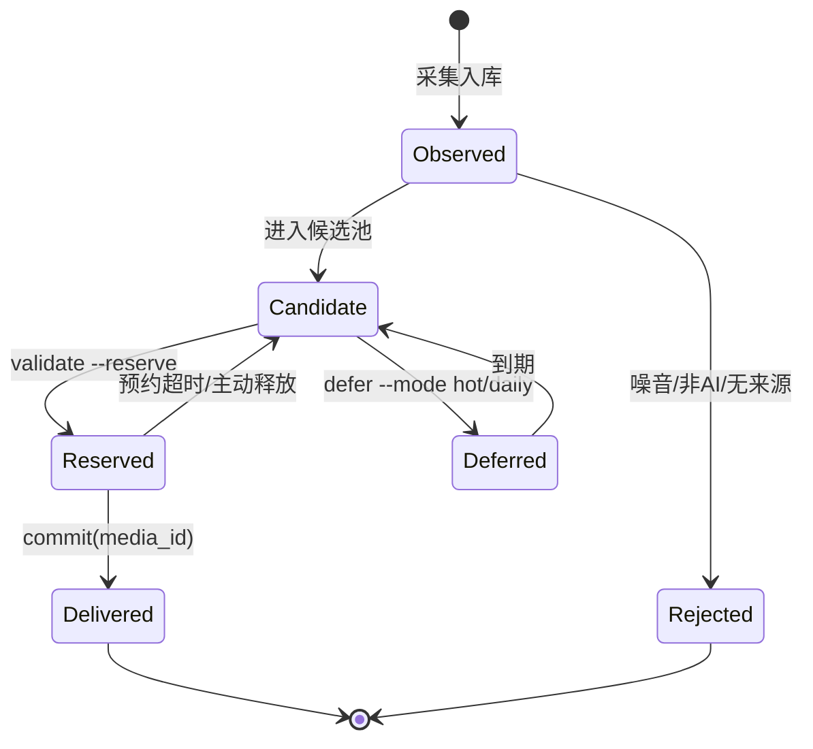

# 架构与状态机

本文说明系统由哪些部分组成、数据如何在组件之间流动，以及失败时会发生什么。阅读顺序建议：先看 README 的「核心设计」，再看本文的「状态机」和「失败语义」。

---

## 1. 设计约束

这套系统不是从「我想做一个 AI 写作平台」出发的，而是从四个真实约束倒推出来的：

1. **每天只有一次窗口**：05:30 开始，07:00 前必须落到草稿箱，不能等人。
2. **微信接口只给草稿权限**：订阅号不能 API 发布，最后一步必须人工。
3. **重复是致命的**：同一事件换个标题再发一次，读者会立刻发现。
4. **事实错误成本高**：一条未核实的传闻会毁掉账号信用。

对应的架构选择：

| 约束 | 选择 |
|---|---|
| 无人值守 | 脚本做所有可判定动作；模型只做判断，不碰接口 |
| 只有草稿权限 | 流程终点固定为 `draft/add`，代码层禁用 `freepublish/submit` |
| 重复致命 | 事件库 + 选题冷却 + 上传闸门，三层独立生效 |
| 事实错误成本高 | 强制研究包、来源链接、核验状态；实测稿必须留原始输出哈希 |

---

## 2. 组件图

```text
┌─────────────────────────────────────────────────────────────────────┐
│                         调度层（Hermes cron / system cron）          │
│  05:30 主流水线      08:00-23:00 每20分钟      20:00 兜底      08:02 日报 │
└───────────────┬─────────────────────┬──────────────────┬────────────┘
                │                     │                  │
                ▼                     ▼                  ▼
        ┌───────────────┐     ┌───────────────┐  ┌───────────────┐
        │ 模型编辑任务   │     │ trigger.py    │  │ trigger.py    │
        │ (10 阶段提示词)│     │ --mode hot    │  │ --mode daily  │
        └───────┬───────┘     └───────┬───────┘  └───────┬───────┘
                │                     │                  │
                │                     ▼                  ▼
                │             ┌───────────────────────────────┐
                │             │ ai_news.py（Horizon 解释器）   │
                │             │ 采集 → 归一化 → 聚类 → 入库    │
                │             └───────────────┬───────────────┘
                │                             │
                │                             ▼
                │             ┌───────────────────────────────┐
                │             │ hot_editor.py                 │
                │             │ 打分 → 优先级 → 配额 → 候选    │
                │             └───────────────┬───────────────┘
                │                             │ 候选 JSON
                ▼                             ▼
        ┌───────────────────────────────────────────────┐
        │ 编辑判断：核验 / 研究包 / 写作 / 审稿 / 标题    │
        └───────────────────────┬───────────────────────┘
                                │ Markdown + 图片
                                ▼
        ┌───────────────────────────────────────────────┐
        │ publish_article.py                            │
        │ render → cover → upload → payload → guard     │
        │ → draft/add → draft/get → mark → notify       │
        └───────────────────────┬───────────────────────┘
                                │
                                ▼
        ┌───────────────────────────────────────────────┐
        │ 微信草稿箱（人工核对 → 声明原创 → 发布）        │
        └───────────────────────────────────────────────┘
```

---

## 3. 组件职责

### 3.1 `ai_news.py`：采集与事件账本

**输入**：`~/.hermes/news/sources.json`、`hot-sources.json`、AIHOT API、RSS、GitHub Releases、HN。

**输出**：

- `events.sqlite3`：事件、文章、交付、预约、延期、拒绝、告警；
- `news/selections/YYYY-MM-DD-<mode>.json`：候选列表；
- `news/health/last-collect.json`：每个源的状态、HTTP 码、原始条数、过滤计数。

**关键行为**：

- 只做规则判断，不调用 LLM；
- 同一事件的多篇文章聚合到一个 `event_id`；
- 版本号不同的事件不合并（`v3` 和 `v4` 是两次发布）；
- 聚合站传闻如果没有官方/媒体/创作者来源，直接拒绝；
- 采集失败不会把 `last_collect` 标记为新鲜，避免「失败一次，20 分钟不再重试」。

### 3.2 `hot_editor.py`：选题排序

**输入**：最近 48 小时（创作者内容 14 天）的事件分组。

**输出**：最多 5 个候选，附 `editorial_score`、`topic_tier`、`region`、`candidate_type`、`evidence_status`。

**打分**：

```text
基础分 45
+25 国内相关
+15 探索/实测/对比类
+10 有官方/媒体/创作者实质来源
+ 5 发布 24 小时内
+15 DeepSeek（topic_tier=0）
+ 8 WorkBuddy（topic_tier=1）
-15 传闻
```

**排序**：

```text
(是否海外, topic_tier, -editorial_score, -发布时间, event_id)
```

即：国内优先 → DeepSeek 优先于 WorkBuddy → WorkBuddy 优先于其他国内 AI → 同档按分数 → 同分按新→ 最后用 `event_id` 保证稳定。

**配额**：

- 当天热点已交付 2 篇 → 停止；
- 20:00 兜底时，当天已有 1 篇 → 停止；
- 海外稿数量超过国内稿的 1/4 → 只保留国内候选；
- 没有合格候选 → 允许空缺，不硬凑。

### 3.3 编辑层（模型）

这一层不在仓库代码里，由 `docs/pipeline.md` 的提示词驱动。模型负责：

- 读候选，打开原文，判断是否值得写；
- 建研究包：时间线、已证实/未证实、作者归属、读者收益、不能推出的结论；
- 写作、去 AI 味、审稿、合规自检；
- 提标题、封面文案。

模型**不直接调用**微信接口，也不直接写 `events.sqlite3`。它通过脚本的 CLI 完成状态变更。

### 3.4 `publish_article.py`：后段编排

一条命令串起 8 个步骤：

| 步骤 | 动作 | 失败即停止 |
|---|---|---|
| 1 | 读 Markdown，取首行标题，检查摘要 ≤70 字节 | 是 |
| 2 | `render_article.py` 渲染正文与预览 | 是 |
| 3 | 检查图片数与图注数一致、标题未泄漏进正文 | 是 |
| 4 | `make_cover.py` 生成封面，校验 1880×800 | 是 |
| 5 | 上传正文图，替换为 `mmbiz` 地址；校验本地文件哈希未变 | 是 |
| 6 | 上传封面，拿 `thumb_media_id` | 是 |
| 7 | 组装 payload，调用 `wechat_duplicate_guard.py` 建稿 | 是 |
| 8 | `draft/get` 回查六项；写回执；发通知 | 是 |

### 3.5 `wechat_duplicate_guard.py`：闸门

它是唯一允许调用 `draft/add` 的入口。两种使用方式：

- CLI：`python3 wechat_duplicate_guard.py --payload draft.json`
- 库：`install()` 后 monkeypatch `requests`，任何 `draft/add` 都会先查重

查重数据源：

1. 草稿箱全量（`draft/batchget`，`no_content=0`）；
2. 已发表列表（`freepublish/batchget`，可能 `48001`）；
3. 本地回执 `written.jsonl` / `daily_written.jsonl`；
4. 长期归档 `wechat-archive.sqlite3`。

---

## 4. 状态机

### 4.1 事件状态



状态存放在不同表：

| 状态 | 表 | 关键字段 |
|---|---|---|
| Observed | `events` + `articles` | `id`、`first_seen`、`url`、`published` |
| Rejected | `rejected` | `reason`、`source`、`title` |
| Candidate | 无独立表 | 由 `articles` 实时分组计算 |
| Reserved | `reservations` | `event_id`、`owner`、`until_at` |
| Deferred | `deferred` | `event_id`、`until_at`、`reason` |
| Delivered | `delivered` | `event_id`、`channel`、`media_id`、`evidence` |

### 4.2 一次热点写作的状态流转

```text
1. trigger.py --mode hot
   └─ ai_news.py hot
      ├─ 采集（AIHOT、RSS、GitHub、HN）
      ├─ 入库（新事件 → events/articles）
      └─ 写 selections/YYYY-MM-DD-hot.json
   └─ hot_editor.py selection()
      ├─ 过滤：48h 窗口、已交付、预约中、延期、历史重复
      ├─ 打分：国内 / 探索 / 来源 / 新鲜度 / 优先级
      ├─ 配额：当天 <2 篇
      └─ 输出 candidates（最多 5 个）

2. 模型读取 candidates
   ├─ 打开原文，建研究包
   ├─ 写稿 → 去 AI 味 → 审稿 → 合规
   └─ 生成最终校验 JSON

3. ai_news.py validate --mode hot --input final.json
   ├─ event_id 可解析
   ├─ URL 是原文，不是 AIHOT / 示例域名
   ├─ 48h 内有来源证据（创作者研究 14 天）
   ├─ 标题点名主体
   ├─ 历史未写过
   └─ --reserve 时占用 2 小时租约

4. publish_article.py
   ├─ render / cover / upload
   ├─ duplicate_guard 查重
   ├─ draft/add
   └─ draft/get 回查

5. mark_written.py
   ├─ commit(delivered)
   └─ 写 written.jsonl

6. notify_draft.py
   ├─ 入 SQLite 队列
   ├─ 飞书发送
   └─ 失败退避重试
```

---

## 5. 数据模型

### 5.1 `events.sqlite3`

```sql
events(id TEXT PRIMARY KEY, title TEXT, first_seen TEXT)
articles(id TEXT PRIMARY KEY, event_id TEXT, title TEXT, url TEXT,
         summary TEXT, published TEXT, source TEXT, kind TEXT,
         rank INTEGER, uuid TEXT, hash TEXT)
aliases(uuid TEXT PRIMARY KEY, event_id TEXT)
delivered(event_id TEXT, channel TEXT, media_id TEXT, at TEXT,
          evidence TEXT, PRIMARY KEY(event_id, channel, media_id))
rejected(id TEXT PRIMARY KEY, reason TEXT, source TEXT, title TEXT, at TEXT)
deferred(event_id TEXT PRIMARY KEY, until_at TEXT, reason TEXT)
reservations(event_id TEXT PRIMARY KEY, owner TEXT, until_at TEXT)
alerts(id TEXT PRIMARY KEY, title TEXT, details TEXT, status TEXT,
       next_at REAL, attempts INTEGER, created_at TEXT)
meta(key TEXT PRIMARY KEY, value TEXT)
```

设计要点：

- `articles` 保留每次观察，不覆盖；`hash` 用标题 + 摘要规范化后计算，便于判断是否同一条。
- `delivered` 的主键包含 `media_id`，同一事件在不同 `media_id` 下可以有多条记录，但选题时按 `event_id` 去重。
- `reservations.owner` 形如 `hot:<sha256(path)>`，同一稿重复 validate 不会自己阻塞自己。
- `deferred` 必须显式带 `--mode`，否则一个栏目的延期会错误阻塞另一个栏目。

### 5.2 回执 JSONL

`written.jsonl`：

```json
{"date":"2026-11-06","at":"2026-11-06T06:58:31+08:00","uuid":"...",
 "event_ids":["evt-..."],"title":"...","rank":0,"media_id":"...",
 "channel":"AI热点","items_file":"/path/to/verify.json"}
```

`mark_written.py` 会先检查同一 `media_id` 是否已有回执；重跑通知不会重复占配额。

### 5.3 通知队列

```sql
notifications(media_id TEXT PRIMARY KEY, title TEXT, channel TEXT,
              chars INTEGER, rank INTEGER, status TEXT,
              attempts INTEGER, next_at REAL, last_error TEXT,
              created_at TEXT, sent_at TEXT)
metadata(key TEXT PRIMARY KEY, value TEXT)
```

- `status`：`pending` / `sent` / `baseline`；
- 退避：`min(900, 60 * 2^min(attempts,4))` 秒；
- 文件锁 `fcntl.flock` 保证多进程不重复发；
- 首次启动把旧 `pending_notifications.jsonl` 导入，已成功的回执标为 `baseline`，不会补发历史。

---

## 6. 失败语义

| 失败点 | 行为 | 是否可重试 | 是否通知 |
|---|---|---|---|
| RSS 源超时 | 记录 `health.status=failed`，继续其他源 | 下一轮 | 否 |
| 全部源失败 | `last_collect` 不更新，保留旧数据 | 下一轮 | 可选告警 |
| AIHOT 解析为空 | 记为 `empty_or_unparsed`，不视为「无新闻」 | 下一轮 | 否 |
| 候选为空 | 正常结束，允许当天空缺 | — | 否 |
| 原文抓取失败 | 该候选放弃，记录缺口 | 人工 | 否 |
| validate 失败 | 停止，不建稿，不通知成功 | 修正后重跑 | 失败通知 |
| 渲染图片/图注不一致 | 停止 | 修正 Markdown | 失败通知 |
| 封面尺寸错误 | 停止 | 重生成 | 失败通知 |
| 图片上传失败 | 停止，保留本地文件 | 重跑 | 失败通知 |
| 查重命中 | 抛出 `ValueError`，请求不发出 | 换选题/换角度 | 失败通知 |
| `draft/add` 失败 | 停止，不写回执 | 修 payload 后重跑 | 失败通知 |
| `draft/get` 回查不一致 | 非零退出，不写成功回执 | 检查草稿 | 失败通知 |
| 通知失败 | 留在队列，指数退避 | 自动 | 重试 |

原则：**失败要么可重试，要么明确停止；不存在「静默跳过」。**

---

## 7. 并发与锁

| 场景 | 锁 | 作用域 |
|---|---|---|
| 采集 | `news/collect.lock`（`flock`，非阻塞） | 同一时刻只允许一个采集进程 |
| 建稿 | `news/.wechat-upload.lock`（`flock`，阻塞） | 查重和 `draft/add` 原子化 |
| 通知 | `workspace/history/.draft_notifications.lock` | 队列 drain 串行 |
| 事件预约 | `reservations` 表 + `BEGIN IMMEDIATE` | 防止两个任务写同一事件 |

采集锁用非阻塞：如果上一轮还没跑完，本轮直接返回 `already_collecting`，不排队。建稿锁用阻塞：宁可等，也不能两个进程同时通过查重。

---

## 8. 为什么不用消息队列 / 数据库服务

这是一个单机、单账号、每天几篇稿子的系统。引入 Redis、RabbitMQ、Postgres 会增加部署和故障面，而收益接近于零。

SQLite + 文件锁足以支撑：

- 每天几十次采集；
- 每天 1–3 次建稿；
- 每天几条通知。

如果要做多账号、多机部署，再把 `ai_news.py` 的存储层抽象出来换 Postgres，其他组件不需要改。

---

## 9. 扩展点

| 想做的事 | 改哪里 |
|---|---|
| 换选题优先级 | `templates/hot-editorial-policy.md` + `hot_editor.py` 的 `FIRST_TIER` / `SECOND_TIER` |
| 加采集源 | `config/sources.example.json` 的 `feeds` / `repos` / `hn_queries` |
| 换排版 | `templates/agent-article-rules.md` + `render_article.py` |
| 换封面风格 | `covers/make_cover.py` 的 `TPL`，或直接用 `render_hot_cover_html.py` |
| 换通知渠道 | `notify_draft.py` 的 `send_feishu()`，队列和重试逻辑不用动 |
| 加新栏目 | `--column` 参数 + 对应提示词；账本按 `channel` 区分 |

---

## 10. 相关文档

- [十阶段执行手册](pipeline.md)
- [部署与运维](operations.md)
- [选题与真实性规则](editorial-policy.md)
- [安全设计与去重闸门](security.md)
