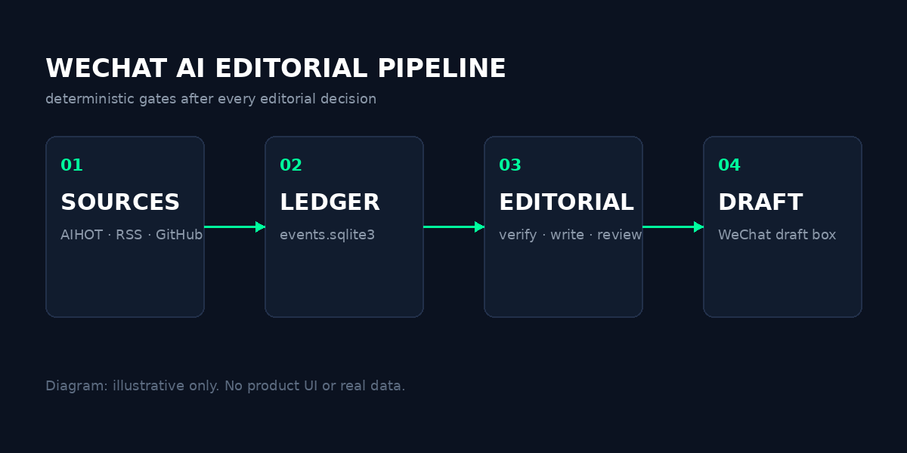

# 把日更交给流水线：一个小团队的内容自动化实验

> 这是一篇示例稿，用于验证渲染器、封面和上传链路。它不是真实新闻，所有数据都是虚构的。上传前请替换成你的文章。

我最初以为，公众号日更最难的是写。

后来发现，写只占三成。剩下七成是：找选题、核事实、配图、排版、上传、查重。每一件都不难，但每天都要做一遍，而且每一件都能出错。

这篇文章记录我们怎么把这七成交给一套流水线，以及它在哪里失败了。

## 先说结论：它没有让我变轻松

上线第一周，我每天还是会打开后台三次。

第一次是早上七点，看草稿有没有进箱；第二次是中午，看阅读量；第三次是晚上，看有没有人留言说“这条昨天发过了”。

流水线解决的是“有没有”，不是“好不好”。它保证每天早上有一篇格式正确、事实有来源、没有重复的稿子躺在草稿箱里。但它不保证这篇稿子有人看。

这是两件事。

图1｜数据从采集到草稿箱的四段结构。示意图，本人绘制，不涉及真实产品界面。

## 我们到底自动化了什么

第一段是采集。AIHOT 的热榜、官方博客的 RSS、GitHub 的 release、还有几个中文源，每 20 分钟拉一次。拉下来的东西不直接写，先入库、聚类、去重。

第二段是判断。脚本按“国内优先、DeepSeek 优先、有原文优先”排个序，把前五个候选交给模型。模型打开原文，判断值不值得写。

第三段是写作。1500 到 2000 字，第一人称，要有具体数字，要承认失败。写完过一遍去 AI 味，再过一遍合规扫描。

第四段是交付。渲染、封面、上传、查重、回查。这一段全是脚本，模型碰不到接口。

## 最有用的一行代码

不是写作提示词，是查重。

查重命中时，脚本直接抛异常，草稿请求不会发出。这行判断在接口调用之前执行，实时读草稿箱、已发表列表和本地历史。

提示词可以写“不要重复”，但模型会忘。代码不会。

## 它在哪里失败过

第一次跑，封面全是方块。服务器没装中文字体。

第二次，正文图片上传成功，但 HTML 里还是本地路径。回查时发现，草稿箱里是裂图。

第三次，摘要写了 28 个中文字，接口报超长。后来才知道限制是 70 字节，不是 70 个字。

第四次，同一件事换了个标题又写了一遍。查重拦住了，但拦得晚——稿子已经写完，白费两小时。

这些失败都没有上新闻，但它们决定了系统的形状：**每一道能自动检查的关卡，都不要留给自觉。**

## 如果你也想试

先别急着接模型。把“采集、渲染、查重、回查”四件事用脚本跑通，再考虑写作。

因为写作是最不容易出错的一步。真正让你半夜爬起来看后台的，是图片裂了、摘要超了、稿子重了。

资料来源：[示例链接](https://example.com/pipeline-notes)

---

本文为示例稿，仅用于验证排版与上传流程。文中人物、时间、数据均为虚构。
